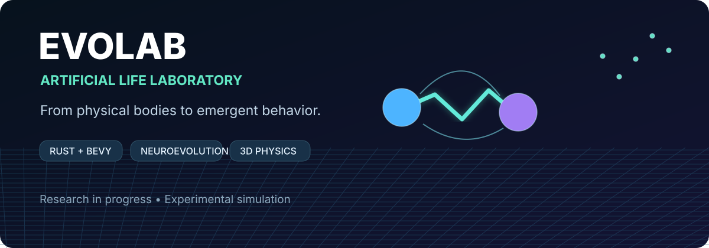
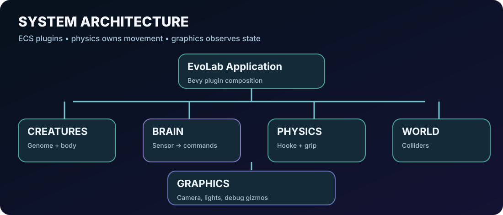
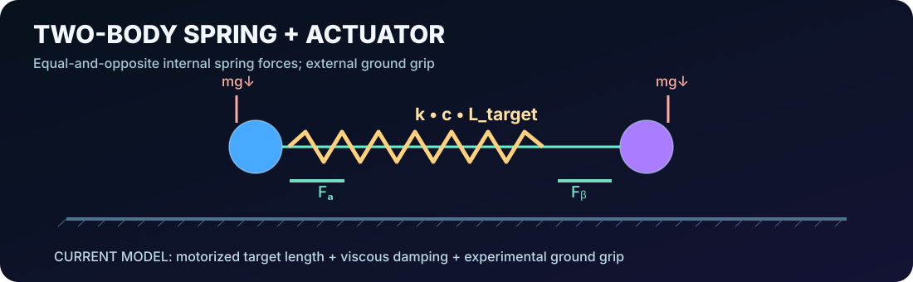
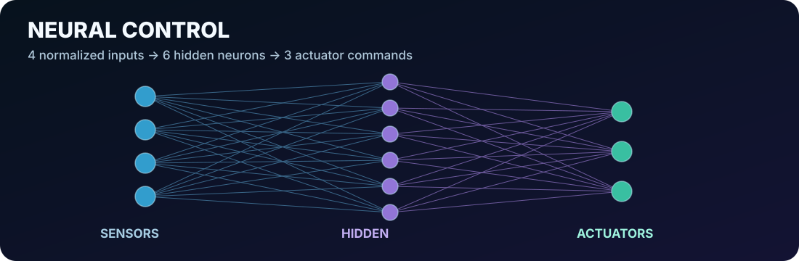
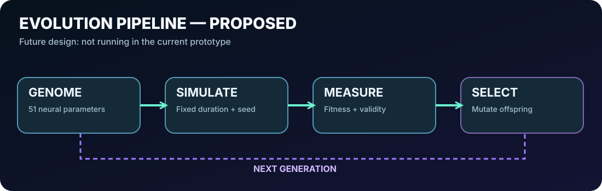
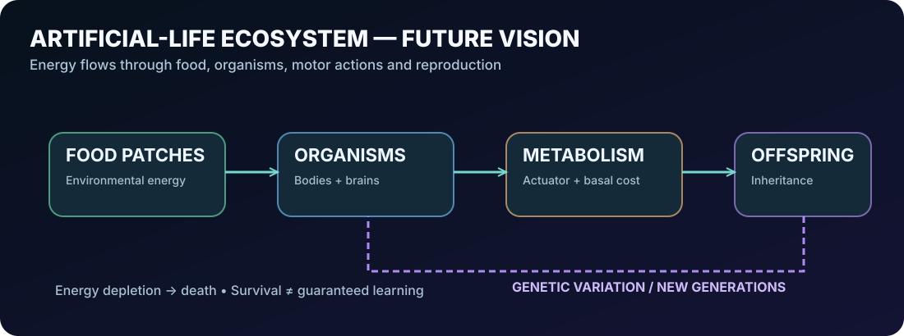

# EvoLab
**An experimental 3D laboratory for embodied intelligence, evolutionary robotics, and artificial life.**

**Rust · Bevy 0.20 · Avian3D 0.8 · Custom neural networks**

[Get started](#getting-started) · [Architecture](docs/architecture.md) · [Physics](docs/physics.md) · [Neural controller](docs/neural-controller.md) · [Future ecosystem](docs/artificial-life.md) · [Roadmap](docs/roadmap.md)

**Documentation language:** English | [Português (BR)](docs/README.pt-BR.md)

> [!IMPORTANT]
> **Project status: experimental prototype, not a trained autonomous organism.**
> The repository currently demonstrates one two-mass spring creature, gravity/contact, a force-based approximation of ground adhesion, and a **manually initialized** neural controller. Evolution, reproduction, energy budgets, adaptive morphology, and ecosystem dynamics are **design goals**, not implemented functionality.

## Why EvoLab exists

What happens when bodies, brains, and environments can change together? EvoLab is being developed as a practical way to investigate this question by combining rigid-body physics, motor control, neural networks, and eventually natural-selection-inspired mechanisms. It is both an engineering project and a research playground: every behavior should emerge from explicitly modeled forces and controls, and every future claim about learning should be supported by repeatable experiments.

**Our long-term ambition:** creatures that must obtain energy, survive, reproduce and adapt—not agents that simply receive a numerical reward for running forward. Locomotion, efficiency, specialization, and morphology should become possible consequences of those ecological pressures. This is a research direction, not a promise that complex behavior will spontaneously emerge.

## What you can run today

The published foundation implements:

- A Bevy ECS application with separate **brain**, **creatures**, **physics**, **graphics**, and **world** plugins.
- A 3D scene with a camera following the organism and a static floor.
- Two dynamic spheres, each with a collision radius of **0.25 m** and mass of **1 kg**, connected by a software-defined spring.
- Hookean spring forces and relative-velocity damping, integrated by Avian.
- A periodic time signal and normalized physical sensors feeding a **4–6–3** fully connected network (**51 trainable parameters in principle**).
- Three motor outputs: spring actuation, left-side adhesion intensity, and right-side adhesion intensity.
- An approximate contact-aware resistive force for locomotion; this is **not a full static-friction foot model**.
- A baseline brain with **hard-coded weights**; no training loop is present.
- A visual spring and phase-based debug markers. **Known mismatch:** these markers do not yet display the actual neural grip output.

The version on the documented GitHub branch uses a finite floor. Newer local work may include a grid, camera modes, or an infinite-floor experiment; those are not asserted as part of this revision.

## Getting started

### Requirements

- Current stable Rust toolchain with edition 2024 support.
- macOS, Linux, or Windows development environment with graphics support for Bevy.
- Enough free disk space for substantial Bevy/Avian build artifacts.
- A supported graphics backend (macOS typically uses Metal).

### Clone, build and run

~~~bash
git clone https://github.com/dwego/EvoLAB.git
cd EvoLAB
cargo fmt --check
cargo check
cargo test
cargo run
~~~

**If your local branch contains uncommitted experiment changes, commit them before pulling or merging documentation updates.**

The project currently depends on:

~~~toml
[dependencies]
avian3d = "0.8"
bevy = "0.20"
rand = "0.10"

[profile.dev]
debug = 0
incremental = false
~~~

The development profile reduces debugging artifacts and incremental compilation storage. The \`rand\` dependency is reserved for upcoming evolutionary operators and is not evidence that random brains are already being evaluated.

> [!TIP]
> If macOS linking fails with \`ld: write() failed, errno=28\`, check free disk space using \`df -h .\`. \`cargo clean\` removes build artifacts but does not fix a permanently full disk.

## Repository map

~~~text
src/
├── main.rs                    # Plugin composition and application entry
├── brain/
│   ├── mod.rs                 # BrainPlugin scheduling
│   ├── network.rs             # Pure numerical MLP, 4→6→3
│   └── controller.rs          # Sensors → neural commands
├── creatures/
│   ├── mod.rs                 # Creature component and CreaturePlugin
│   ├── genome.rs              # Current motor/body parameters
│   └── spawn.rs               # Two-sphere embodiment
├── physics/
│   ├── mod.rs                 # FixedPostUpdate force order
│   ├── springs.rs             # Hooke + viscous damping + actuation
│   └── grip.rs                # Temporary resistive foot model
├── graphics/
│   ├── mod.rs                 # GraphicsPlugin
│   ├── camera.rs              # Smooth follow camera
│   ├── scene.rs               # Camera and light
│   └── debug.rs               # Spring gizmo and optional tracing
└── world/
    └── mod.rs                 # Static arena and ground collision

docs/
├── architecture.md            # ECS boundaries and runtime flow
├── physics.md                 # Derivations, units, numerical cautions
├── neural-controller.md       # Inputs, outputs, weights, limitations
├── experiments.md             # Reproducibility and proposed test protocol
├── evolution.md               # Planned neuroevolution pipeline
├── artificial-life.md         # Planned energy/food/reproduction system
├── roadmap.md                 # Honest implemented/proposed milestone map
├── contributing.md            # Development workflow
└── README.pt-BR.md            # Portuguese overview and navigation

src/*/README.md                # Module-specific maintenance notes
assets/*.svg                    # Source-controlled vector diagrams
~~~

## Physics in one minute

For mass positions \(\mathbf{x}_a,\mathbf{x}_b\), define the separation:

$$
\mathbf{d} = \mathbf{x}_b-\mathbf{x}_a,\quad
\ell = \|\mathbf{d}\|,\quad \hat{\mathbf{d}}=\frac{\mathbf{d}}{\ell}.
$$

Let the target length be controlled by the neural output \(u_m\in[-1,1]\):

$$
\ell_{\mathrm{target}}=\max(0.3,\ell_0+A\,u_m).
$$

The force **on the left mass** is

$$
\mathbf{F}_a=
\left[k(\ell-\ell_{\mathrm{target}})+
c(\mathbf{v}_b-\mathbf{v}_a)\cdot\hat{\mathbf{d}}\right]\hat{\mathbf{d}},
\qquad
\mathbf{F}_b=-\mathbf{F}_a .
$$

This is Hooke's law plus a longitudinal damping term. Gravity, contact and numerical integration are handled by Avian. The spring force is an **internal force pair**; in isolation it cannot accelerate the center of mass.

The adhesion prototype applies, near the ground, a *separate external horizontal force* to each body:

$$
\mathbf{F}_{\mathrm{grip},i} =
\mathrm{clampMagnitude}\left(
-45\,g_i\,\mathbf{v}_{i,xz},\;35\,g_i\right),
\quad g_i\in[0,1].
$$

This model is velocity-dependent damping with a force cap, **not Coulomb static friction, anchoring, or a proof of physically realistic walking**. See [Physics and model limitations](docs/physics.md).

## Neural controller

The inputs are normalized spring extension, relative axial speed, \(\sin\phi\), and \(\cos\phi\). The hidden layer and outputs use \(\tanh\); grip outputs are subsequently remapped to \([0,1]\).

$$
\mathbf{h}=\tanh(W_{ih}\mathbf{s}+\mathbf{b}_{h}),\qquad
\mathbf{o}=\tanh(W_{ho}\mathbf{h}+\mathbf{b}_{o}).
$$

The current reference controller is **hand-wired**, not learned. Its oscillating phase inputs implement a useful test behavior. Read the [neural-controller specification](docs/neural-controller.md) to see exact indices, dimensions and test coverage.

## Current runtime

1. At startup, the world spawns the ground, graphics spawns camera/light, and creatures spawns the two spheres.
2. In \`FixedUpdate\`, \`BrainPlugin\` calculates motor commands from physical state.
3. In \`FixedPostUpdate\`, after Avian preparation and before simulation, the spring system applies equal-and-opposite forces and advances creature time.
4. The grip system applies its separate, contact-proximity-limited horizontal resistive forces.
5. Avian integrates and resolves collision contacts.
6. Graphics renders the world and makes the camera follow the organism.

The application is **not** yet headless, and the physics is **not** yet verified against a full analytic or energy-accounting benchmark.

## From a crawler to an ecosystem

The near-term idea is neuroevolution—multiple candidate neural weights, fixed trial duration, identical initial conditions, ranking and mutation. But the larger direction is artificial life:

A world with resource patches, an energy budget, reproduction thresholds, offspring mutation, and death from insufficient energy. Ultimately, **offspring and ecological persistence**, rather than forward distance alone, should determine evolutionary success.

These systems do **not yet exist**. Start with [planned evolution](docs/evolution.md), [artificial-life design](docs/artificial-life.md), and the [roadmap](docs/roadmap.md).

## Scientific principles

- **Reproducibility:** seeds, fixed initial states, trial durations and versioned configurations.
- **Controls:** compare against a no-controller baseline, the hand-wired reference and random policies.
- **Physics-first:** no manually teleporting bodies to manufacture locomotion.
- **Model transparency:** clearly mark approximations (currently the grip force).
- **Honest selection:** detect NaNs, physically invalid escapes and reward hacking.
- **Ablations:** vary one mechanism at a time before claiming a causal explanation.
- **Visualization ≠ measurement:** all reported movement should come from simulator state, not a moving camera.

See [experimental design](docs/experiments.md).

## Development guide

~~~bash
cargo fmt
cargo check
cargo test
cargo run
~~~

Useful first contributions: repair phase-based grip gizmos so they show neural outputs, expand unit tests, add telemetry, implement selectable camera modes and a spatial grid, and introduce a reliable resettable simulator episode.

[Contribution guidance](docs/contributing.md) · [Module READMEs](src/brain/README.md)

## License and attribution

**License not yet selected.** Do not assume that the repository is MIT/Apache licensed until a \`LICENSE\` file is committed. Bevy and Avian remain separate upstream projects with their own licenses.

Built as an experimental open-source research project. Not a validated biomechanical or ecological simulation.
