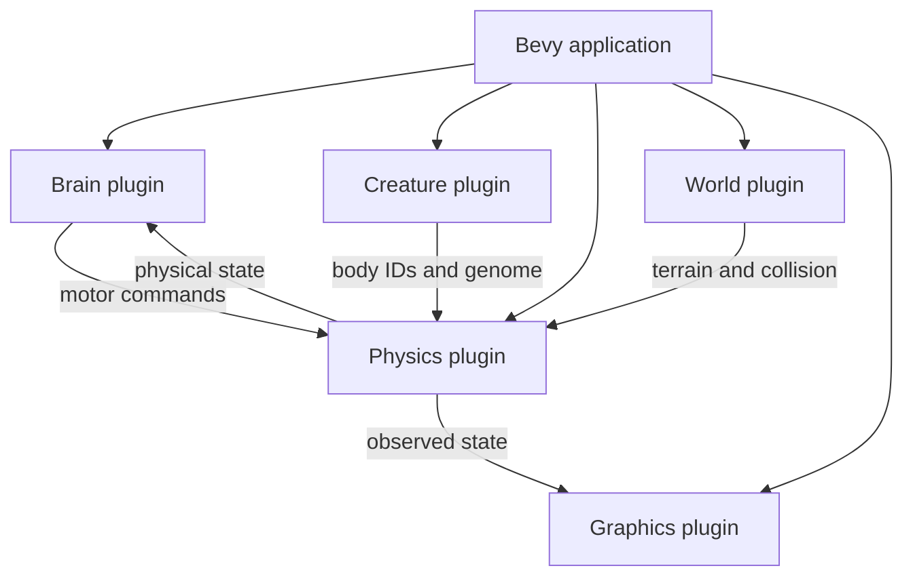
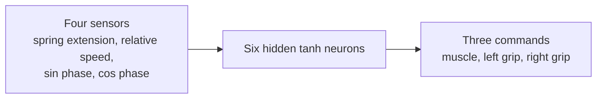
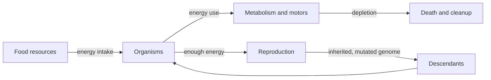

# EvoLab — Guia em português

**EvoLab** é um laboratório experimental de vida artificial em Rust: física 3D, criaturas com corpos simulados e controladores neurais; futuramente, evolução e ecossistemas.

> **Situação atual:** já existe uma criatura composta por duas esferas unidas por uma mola motorizada, com gravidade, colisão, uma aproximação de aderência e um cérebro neural configurado manualmente. **Não existe treinamento evolutivo, alimentação, mortalidade ou reprodução implementados.** Esta documentação separa sempre o código existente das propostas futuras.

## Para executar

~~~bash
git clone https://github.com/dwego/EvoLAB.git
cd EvoLAB
cargo fmt --check
cargo check
cargo test
cargo run
~~~

Tecnologias: Rust 2024, Bevy 0.20, Avian3D 0.8, `rand` 0.10.

## Como o projeto está organizado

*Arquitetura dos módulos atuais.*

| Pasta | Responsabilidade | Como está hoje |
|---|---|---|
| `src/brain` | Rede neural e tradução de sensores em comandos | MLP 4→6→3 com 51 parâmetros e pesos iniciais definidos manualmente |
| `src/creatures` | Genoma, massa, montagem do corpo | Duas esferas de 1 kg e raio 0,25 m |
| `src/physics` | Motor muscular, amortecimento e aderência | Hooke, damping longitudinal e amortecimento horizontal de contato |
| `src/graphics` | Câmera, iluminação e gizmos | Câmera de acompanhamento e mola desenhada |
| `src/world` | Terreno e contato | Chão estático finito na versão documentada |

O `main.rs` apenas registra os plugins. Isso reduz o acoplamento entre o cérebro, a física e o renderer.

## Física fundamental

A mola calcula o comprimento real $\ell$, compara com o comprimento-alvo $\ell_t$ e produz forças opostas nas duas massas.

$$
\mathbf{F}_a =
[k(\ell-\ell_t)+c\,(\mathbf{v}_b-\mathbf{v}_a)\cdot\hat{\mathbf{d}}]\hat{\mathbf{d}},
\qquad \mathbf{F}_b=-\mathbf{F}_a.
$$

O cérebro controla $\ell_t=\max(0{,}3,\ell_0+A u_m)$. A gravidade, colisões e integração numérica são responsabilidade do Avian. O solo usa atrito de contato, mas **as esferas têm atrito físico definido como zero**: uma força externa horizontal artificial fornece aderência controlável. Essa aproximação precisa ser substituída para estudos biomecânicos rigorosos.

## Cérebro

A entrada possui quatro valores: deformação normalizada da mola, velocidade axial relativa, seno da fase e cosseno da fase. A rede possui seis neurônios ocultos e três saídas: motor, aderência esquerda, aderência direita.

**Importante:** essa rede **não aprendeu**. A função `baseline()` fixa alguns pesos para imitar uma marcha periódica. A evolução desses pesos ainda será construída.

## O que queremos criar

*Ecossistema proposto, ainda não implementado.*

A visão maior é uma simulação ecológica, sem depender apenas de fitness por velocidade. Organismos terão gasto energético basal, gasto por atuação muscular, acesso a recursos, limiar de reprodução, mutações e morte por exaustão. Mais adiante, cérebros e corpos poderão coevoluir; poderemos pesquisar diversidade comportamental, especialização, estabilidade e competição.

**Isso é planejamento, não funcionalidade existente.** Não há garantia de surgimento espontâneo de comportamentos complexos; serão necessários experimentos e controles.

## Documentação aprofundada

- [Arquitetura e ECS](architecture.md)
- [Equações e física](physics.md)
- [Rede neural e sinais](neural-controller.md)
- [Como medir experimentos](experiments.md)
- [Neuroevolução planejada](evolution.md)
- [Ecossistemas e energia](artificial-life.md)
- [Roadmap](roadmap.md)
- [Como contribuir](contributing.md)
- READMEs por módulo: [brain](../src/brain/README.md), [creatures](../src/creatures/README.md), [physics](../src/physics/README.md), [graphics](../src/graphics/README.md), [world](../src/world/README.md)

Para informações sobre instalação, licenciamento e comandos, consulte também o [README principal em inglês](../README.md).
