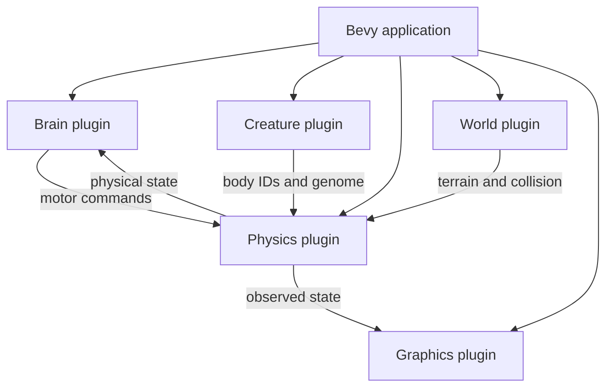

# Architecture and execution model

## Objectives

EvoLab should ultimately support interactive visualization **and** deterministic, repeatable, headless evaluations. The current repository is a single executable Bevy application; the modular plugin layout is a starting point, not a headless research system yet.

## Existing plugin graph

| Plugin | Implementation | Ownership |
|---|---|---|
| `DefaultPlugins` | Bevy | windows, rendering, scheduling, asset resources |
| `PhysicsPlugins::default()` | Avian | rigid bodies, integration, contacts |
| `WorldPlugin` | `world/mod.rs` | static ground |
| `BrainPlugin` | `brain/mod.rs` | sensor sampling and network execution |
| `GraphicsPlugin` | `graphics/mod.rs` | camera/light/visual debug |
| `CreaturePlugin` | `creatures/mod.rs` | spawn organism and components |
| `SpringPhysicsPlugin` | `physics/mod.rs` | spring and grip force systems |

The top-level `main.rs` composes these plugins and does not itself spawn geometry.

## ECS boundaries

A `Creature` is a Bevy component, not a monolithic object containing copy-pasted position data. It stores `masses: [Entity; 2]`, a `Genome`, `stiffness`, `damping`, and `elapsed`. The physics engine stores `Position`, `LinearVelocity`, rigid-body and collider components on the two separate sphere entities.

A `NeuralController` is attached to the same logical creature entity as `Creature`. It holds `NeuralNetwork` and the last `MotorCommands`. This allows the controller to consume physical observations and publish commands without directly mutating transforms.

### Data ownership rule

- **Creatures:** organism identity and morphological/motor parameters.
- **Brain:** numerical policy plus observations → commands.
- **Physics:** transforms commands into force contributions.
- **Avian:** integrates rigid-body states and contacts.
- **Graphics:** reads state for display; never fabricates movement.
- **World:** defines the environment and resources.

## Scheduling and causality

~~~text
Startup:
    WorldPlugin -> ground
    GraphicsPlugin -> camera/light
    CreaturePlugin -> two spheres + logical organism

Each fixed tick:
    FixedUpdate       Brain::update_brains
    FixedPostUpdate   Avian Prepare
                      Spring::apply_spring_forces
                      Grip::apply_grip_forces
                      Avian StepSimulation
                      Avian Writeback

Each rendered frame:
    Update            draw_springs
    PostUpdate        camera::follow_creature
~~~

In the actual code, spring and grip systems use `.chain()`, `.after(PhysicsSystems::Prepare)`, and `.before(PhysicsSystems::StepSimulation)`. The brain system is currently in `FixedUpdate`. This order matters: the physics step consumes the most recently calculated commands.

**Current limitation:** the world step, rendering and fixed scheduling are still tied to the Bevy application. Running thousands of episodes quickly requires a repeatable reset/evaluation interface; simply hiding the window is not the finished architecture.

## Future architecture: separate concerns by API

~~~text
ExperimentRunner
    ├── Population / Genome
    ├── EpisodeConfig (seed, duration, initial pose, terrain)
    ├── SimulationRunner (reusable/resettable physics world)
    │    ├── BodyPhenotype
    │    ├── BrainPolicy
    │    ├── Sensors
    │    ├── Actuators
    │    ├── EnergyModel
    │    └── ResourceWorld
    ├── Measurements / ValidityChecks
    ├── Selection / Variation
    └── Snapshots / Replay / Renderer
~~~

Proposed interfaces (illustrations, **not compiled API**):

~~~rust
trait Policy {
    fn act(&mut self, observation: &[f32]) -> Vec<f32>;
}

struct EpisodeResult {
    displacement_x: f32,
    energy_used: f32,
    survived_seconds: f32,
    valid: bool,
}

trait EpisodeEvaluator {
    fn evaluate(&mut self, genome: &GenomeCandidate, seed: u64) -> EpisodeResult;
}
~~~

Use fixed-step simulation, explicit seeds and serialization of successful brains before trying concurrency. Avoid parallelizing shared ECS state until isolation is understood.

## Design risks

1. **Simulation exploit:** optimizer finds a loophole in collision/damping math rather than a plausible strategy.
2. **Visual mismatch:** debug markers render the old phase heuristic, not neural grip outputs.
3. **State leakage:** resettable episodes accidentally inherit residual velocities, contact state or pseudo-random state.
4. **Nondeterminism:** variable timestep and interleaved RNG calls introduce biased comparisons.
5. **Complexity creep:** adding morphology, metabolism and reproduction before reliable episode evaluation obscures causes.

## Architectural acceptance checklist

- `cargo check` passes after each module change.
- Every new plugin owns clearly named systems and state.
- Pure mathematical modules have unit tests without graphics.
- Experiment results include configuration and version information.
- The visual replay reconstructs measured behavior using the same configuration.
