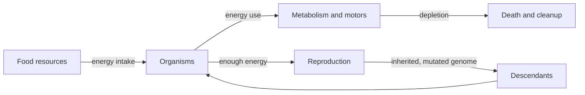

# Artificial life: energy, resources and ecology

> **Research direction only.** No food, metabolism, death, reproduction or evolutionary ecology exists in the current implementation.

## Core question

Can a physically embodied population evolve useful strategies when selection emerges from the environment (resource capture, survival and viable reproduction), rather than from an explicit “move forward” reward?

We aim to create an ecosystem where action has a cost, resources are unevenly distributed, and a lineage survives by passing on useful traits.

## Proposed minimal ecology

Each creature would have:
- **Body:** rigid or deformable segments, actuator geometry, contact surfaces.
- **Brain:** sensory policy producing continuous motor commands.
- **Energy store:** a bounded quantity in consistent units.
- **Metabolism:** nonzero baseline consumption.
- **Actuator costs:** based on motor force/velocity/work and actuator efficiency.
- **Reproduction threshold:** reserves enough energy for offspring creation.
- **Age and failure conditions:** energy depletion, structural damage, or other defined rules.

Food patches would have world position, available energy, collection radius, replenishment behavior and possibly carrying capacity.

## Energy budget

A candidate accounting identity is:

$$
E(t+\Delta t)=E(t)+E_{\rm food}
-E_{\rm basal}-E_{\rm actuator}-E_{\rm other}.
$$

One possible continuous model:

$$
\dot E=P_{\rm intake}-P_{\rm basal}
-\sum_j P_{{\rm actuator},j}.
$$

Motor power for a linear actuator can be related to force and relative velocity:

$$
P_j=F_j\,v_{{\rm rel},j}.
$$

This signed mechanical power is **not identical** to metabolic consumption. A realistic actuator cost might account for both positive mechanical work and inefficiency or thermal losses; regenerative behavior requires explicit assumptions. The choice of metabolic model strongly affects evolution.

## Reproduction

A proposed rule:

- Require adulthood or minimum age (optional).
- Require energy $E\ge E_{\rm reproduction}$.
- Subtract offspring construction cost from parent.
- Spawn an offspring with mutated inherited genome and its own initial energy.
- Log parent ID, mutation seed, time, and location.
- End or mark the parent if energy falls to zero.

Any inherited behavioral memory must be defined deliberately; initial v0.1 offspring should probably inherit neural weights, **not** arbitrary transient controller state.

## Death and cleanup

On death, remove creature entities, stop controllers, release resources, update lineage tracking and optionally recycle biomass into food. ECS despawning must clean up all physical child entities and joint constraints; otherwise invisible collision debris can corrupt experiments.

## Environmental controls

Use scenarios to test ecological hypotheses:

| Scenario | Manipulated variable | Question |
|---|---|---|
| Abundance | resource density | do economical and fast morphs coexist? |
| Scarcity | resource availability | is efficiency selected? |
| Patchiness | clustered food locations | does searching/turning matter? |
| Competition | concurrent population size | does crowding change strategy? |
| Change | resource schedule over time | do adaptable lineages persist? |
| Perturbation | terrain, gravity, disturbances | are strategies robust? |

Control seeds and initial layouts. Replicate runs: one apparent “evolutionary trend” could be an accident of random resource placement.

## Open-ended evolution caveats

Population ecologies can stagnate, collapse, or exploit modeling quirks. Survival pressure does **not** ensure emergence of intelligence, walking or complex social dynamics. We should measure diversity, ancestry, extinction events, energy flow and reproduction—without anthropomorphizing behavior.

## Suggested implementation order

1. A deterministic resource-free episode harness with reset.
2. Energy model independent of graphics.
3. Motor energy usage and basal cost.
4. Food patches with collision/proximity collection.
5. Creature-specific sensory fields for food.
6. Reproduction and genome mutation.
7. Death and cleanup with explicit genealogy.
8. Multiple concurrent organisms.
9. Morphology and neural topology mutation.
10. Novelty and niche diversity analysis.

This sequence intentionally delays a persistent, complicated ecosystem until the physics and experiment infrastructure are trustworthy.
