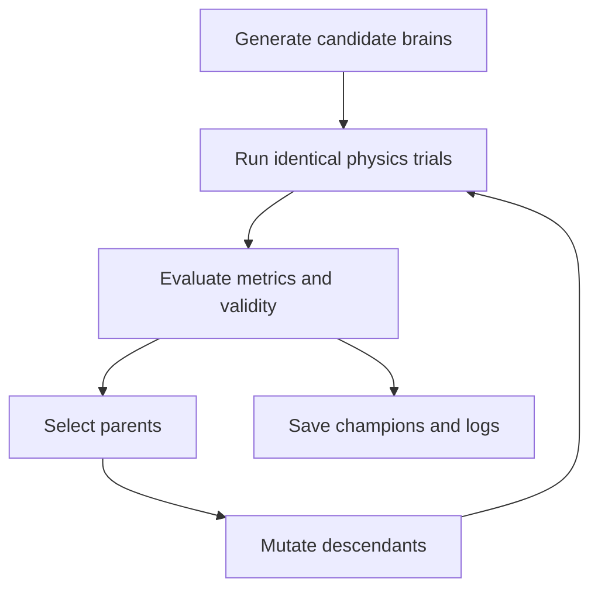

# Evolution engine — proposed design

> **Not yet implemented.** This document is the design specification for future neuroevolution, not a description of a running optimizer.

## Why evolution?

Our prototype can already demonstrate a periodic neural controller. The next objective is to investigate whether the controller parameters can be *discovered* by selection rather than provided by hand. Initially, bodies stay fixed and only neural weights and biases change. Eventually, anatomy and metabolism may be part of the genotype.

## Representation

Current brain: fixed 4→6→3 MLP, 51 numeric parameters. A candidate genotype is a finite float vector of length 51 plus metadata (seed, generation, parent ID, mutation configuration).

Proposed structs—not present in code:

~~~rust
struct Candidate {
    id: u64,
    weights: [f32; 51],
    generation: u32,
}

struct TrialMetrics {
    displacement_x: f32,
    energy_consumed: f32,
    distance_to_food: f32,
    survived: bool,
    numerically_valid: bool,
}
~~~

Avoid conflating candidate identity with an ECS entity ID; entities are runtime handles and not stable IDs for lineage graphs.

## Evaluation

An evaluation must reset all relevant physical state: world, body poses, velocities, contacts, controller state, energy, and pseudorandom generator. Candidate A and candidate B should receive **identical initial conditions**, or a controlled panel of identical seeds.

Fixed-duration episodes (for example, 10 simulated seconds) are useful during development. For ecosystem experiments, a creature may reproduce or die before episode end.

## Selection and variation

Proposed first baseline:

1. Sample 30 finite random brain vectors with a deterministic seed.
2. Evaluate all brains against the same reference scenario.
3. Preserve a small number of elites unchanged.
4. Choose parents with tournament selection.
5. Add bounded Gaussian noise to weights.
6. Evaluate again and log every generation.
7. Export the best genome and its complete evaluation configuration.

Variation example:

$$
w_i'= \mathrm{clip}(w_i+\epsilon_i,-w_{\max},w_{\max}),
\qquad \epsilon_i\sim\mathcal N(0,\sigma^2).
$$

Crossover is optional; it is not necessary for the first experiment. Consider adaptive mutation magnitude if search stalls.

## What counts as fitness?

**Short-term debug benchmark:** signed X displacement under the same duration and physics conditions.

$$
F_{\rm movement}=x_{\rm final}-x_{\rm initial}.
$$

**Important:** distance alone incentivizes whatever makes X large—even pathological actuator behaviors, numerical errors, or exiting the intended simulation region. A future energy-aware benchmark might use multiple objectives:

$$
\mathbf f =
(\text{distance},-\text{motor work},\text{stability},\text{survival}).
$$

Do not arbitrarily combine incompatible scales without justification; Pareto or quality-diversity approaches may be more informative.

## Long-term shift to artificial life

The eventual goal is not to optimize a single global scalar per episode. It is to model an ecology where energy collection, offspring production and survival determine lineage persistence. This needs careful design to avoid built-in behaviors being misrepresented as emergent.

Reproductive success may be measured over an observation horizon by **viable offspring**, not a prescriptive speed reward.

## Novelty and quality-diversity

A behavior descriptor might include:

$$
b=(\text{average speed},\text{energy per meter},
\text{path curvature},\text{stance symmetry}).
$$

Map-Elites or novelty search can preserve diverse locomotion strategies instead of collapsing the population onto one fast baseline. Behavior descriptors must remain stable across versions, with explicit normalization and cell boundaries.

## Reproducible results

Every run should record:
- source revision and config hash;
- RNG seed(s);
- population and operator settings;
- physics time step and solver version;
- episode initialization and invalid-run rules;
- best/median fitness and diversity per generation;
- weights and rollout of each saved champion.

Prefer CSV/JSON for results and a machine-readable experiment manifest. A screenshot of a moving creature is **not** adequate evidence of successful evolution.

## Acceptance criteria for v0.3

- At least one end-to-end population run with deterministic candidate generation.
- Resettable or isolated simulation episodes.
- Clear comparative controls (random vs hand-wired baseline).
- No direct renderer dependency in evaluator.
- Invalid run handling for NaN, overflow, escaping world and contact failure.
- A simple graph of fitness and saved replay.
