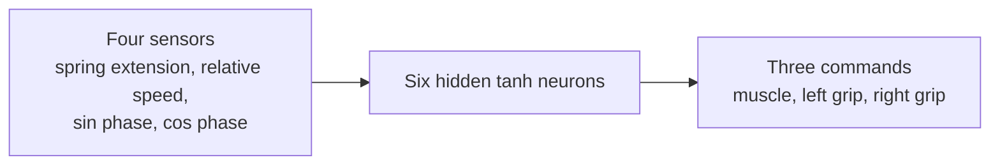

# Neural controller — design and implementation

## Current status

A numerical feedforward neural network **exists**, but its weights are filled by a **manually constructed baseline**, not trained. It does not use backpropagation, reinforcement learning or evolutionary search yet.

## Network dimensions

| Layer | Size | Function |
|---|---:|---|
| Input | 4 | normalized physical sensors + periodic phase |
| Hidden | 6 | `tanh` neurons |
| Output | 3 | `tanh` motor commands |

The learnable numeric state comprises:

$$
4\cdot 6 + 6 + 6\cdot 3 + 3 = \boxed{51}
$$

parameters (42 weights and 9 biases).

The current fixed architecture is easy to evaluate and later mutate. It is not intended to be the final brain morphology.

## Sensor vector

The current `update_brains` implementation reads `Position` and `LinearVelocity` from both masses.

Let $\ell=\|\mathbf{x}_b-\mathbf{x}_a\|$ and $\hat{\mathbf d}$ be the unit separation direction. Then:

$$
s_0=\mathrm{clip}\left(\frac{\ell-\ell_0}{0.5},-1,1\right)
$$

$$
s_1=\mathrm{clip}\left(
\frac{(\mathbf{v}_b-\mathbf{v}_a)\cdot\hat{\mathbf d}}{2},
-1,1\right)
$$

$$
s_2=\sin\phi,\qquad s_3=\cos\phi
$$

with $\phi=2\pi f\,t+\phi_0$.

**Crucial note:** phase input provides a built-in periodic clock. The controller can imitate a gait without detecting the environment. Future ablation tests should remove the clock and compare outcomes.

## Forward propagation

For input $\mathbf s\in\mathbb R^4$:

$$
\mathbf h=\tanh(W_{ih}\mathbf s+\mathbf b_h),
\qquad
W_{ih}\in\mathbb R^{6\times4},
$$

$$
\mathbf o=\tanh(W_{ho}\mathbf h+\mathbf b_o),
\qquad
W_{ho}\in\mathbb R^{3\times6}.
$$

The implementation is plain Rust loops over fixed-size arrays, with `tanh` as the nonlinearity. No GPU or external ML runtime is involved.

The three outputs mean:

| Output index | Mapping | Physical use |
|---|---|---|
| 0 | $[-1,1]$ | change target spring length |
| 1 | $(o_1+1)/2$ | left grip intensity |
| 2 | $(o_2+1)/2$ | right grip intensity |

Grip intensities are clamped to $[0,1]$.

## Baseline wiring

`NeuralNetwork::baseline()` initializes all weights/biases to zero and populates only a few phase-dependent connections. Hidden neurons 0, 1 and 2 transform $\sin\phi$, $+\cos\phi$ and $-\cos\phi$, respectively; output neurons multiply the relevant hidden values and pass them through `tanh`.

The baseline therefore approximates a periodic extension/contraction and alternating grip strategy. It is a **control baseline**, not an evolved result, and not a general neural intelligence.

## Execution semantics

The `BrainPlugin` runs `update_brains` in `FixedUpdate`. It stores `MotorCommands` on the logical organism. Later fixed-post-update physics systems consume those commands. This separation allows replacing the policy without rewriting spring force calculations.

## Unit testing

Current repository includes one test, `opposite_phases_swap_grip`, verifying opposite cosine phases swap grip preference.

Recommended new tests:

- Zero weights and zero biases produce zero raw outputs.
- Outputs remain finite and in $[-1,1]$ for bounded finite sensors.
- Length normalization is symmetric around $\ell_0$.
- Baseline phases produce expected ordering.
- Mutation does not introduce NaN/Inf.
- Neural command outputs are clipped before being applied to motors.
- Saved weight arrays round-trip without losing dimensions.

## Proposed extensions (not yet implemented)

- Seeded randomized initialization, genome mutation and crossover/selection.
- Recurrent hidden state for memory across time.
- Body and brain genotype co-evolution.
- Contact, orientation, distance-to-food, energy, occlusion and tactile sensors.
- Actuator efficiency constraints and energy charging.
- Policy serialization, rollouts and versioned metadata.
- Novelty search and behavior descriptors.

## Critical caveats

A neural network is not automatically a learning system. Learning requires a measurable objective, exploration/variation mechanism, evaluation, and reproducible feedback. The current baseline merely provides a useful starting policy for comparison.
